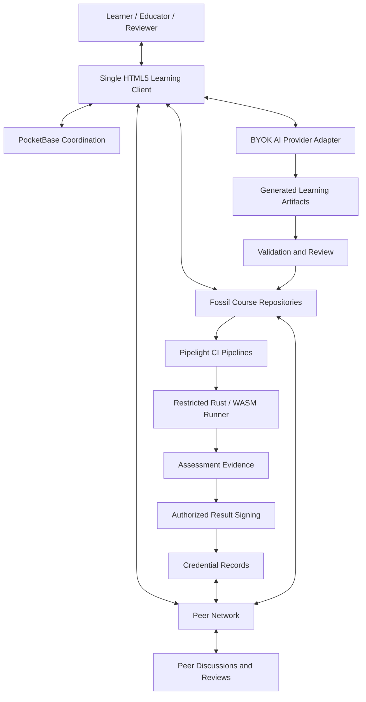
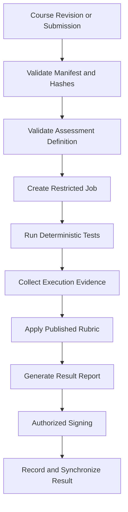

# Vidyarthi — Technical White Paper and Preliminary Architecture Specification

> Source: `Vidyarthi_White_Paper.docx` — **Version 0.1, Initial Proposal, 11 Oct 2026,
> status: Proposed architecture. Project: Vidyarthi — Digital Distributed University.**
> This file distills the docx so the repo is inspectable without proprietary tooling (§1.3).
> The docx remains the archival source; this markdown is a faithful derivative.
> Status: architectural proposal — components are not all integrated, no independent
> security audit is claimed, and future credentials are not automatically accredited (§C).

## Abstract

Vidyarthi is a decentralized, AI-assisted micro-learning university: learning resources,
practical assessment, peer collaboration, and portable achievements through a lightweight,
offline-capable environment. It combines version-controlled course repos, a minimal web
frontend, a lightweight backend, automated assessment pipelines, user-controlled (BYOK) AI,
P2P networking, gamification, and verifiable credentials.

Stack: **Fossil SCM** (courses), **single HTML5 + vanilla JS/CSS** (client), **WebAssembly**
(portable execution), **PocketBase** (coordination), **Pipelight** (CI/assessment), **BYOK AI**,
**Rust** (execution/verification/networking). **Local-first, not unconditionally
decentralized**: study offline; sync via peers when available. **No blockchain for the
initial release** — signed records + append-only history first; consensus only if governance
requires it. Covers objectives, architecture, content, AI, assessment, incentives,
credentials, security, governance, roadmap.

Keywords: decentralized education, micro-learning, P2P, AI-assisted education, OER,
automated assessment, Fossil SCM, Pipelight, WASM, portable credentials, gamification.

## 1. Introduction

### 1.1 Problem
Centralized platforms fragment resources across LMSs/videos/docs, resist forking/verification/
preservation, generate inconsistent AI content, scale practical assessment poorly, lock records
in single orgs, separate peer learning from courses, and exclude via connectivity/cost/vendor lock-in.
Vidyarthi treats education as distributed work among learners, educators, maintainers,
assessment providers, and issuers.

### 1.2 Vision
Discover → study offline → AI guidance → verifiable exercises → peer collaboration →
research contribution → portable competency evidence. Runs on ordinary PCs (and where feasible,
single-board computers / removable storage) without a permanent central server — toward an
ecosystem where communities create, teach, assess, and recognize learning with open tools.

### 1.3 Principles
Local-first; repository-native; AI-assisted but human-accountable (AI never confers authority);
provider-independent (incl. local models); composable; open/inspectable (courses, rubrics,
policies auditable); evidence-based (outcomes, not engagement); portable (export everything);
resource-efficient; security by design (validate untrusted content/submissions/AI output/peers).

## 2. System overview — six layers

| Layer | Responsibility | Technology |
| --- | --- | --- |
| Learning interface | Lessons, quizzes, dashboards, offline | HTML5, vanilla JS, CSS |
| Academic content | Packages, history, projects, refs | Fossil SCM, Markdown, JSON |
| Application coordination | Accounts, discovery, sync metadata | PocketBase |
| AI assistance | Tutoring, generation, feedback | BYOK adapters, local endpoints |
| Execution & assessment | Validation, execution, scoring | Pipelight, Rust, WASM |
| Distribution & trust | Sync, signed results, credentials | Fossil sync, optional libp2p, pubkey crypto |

Layers are logical, not mandatory servers. Minimal deploy: browser + local Fossil +
local assessment + PocketBase; add P2P/credentials later.



## 3. Courses as versioned artifacts (Fossil SCM)

Courses are academic packages (syllabus, outcomes, notes, slides, assessments, exercises,
refs, projects, media) in Markdown/JSON — no proprietary tooling needed. History enables
inspection, branching, sync, and pinning evidence to revisions.

Reference layout (§3.2): `course/{course.json,syllabus.md,prerequisites.md,manifest.json,
lessons/01-foundations/{lesson.md,slides.md,quiz.json,exercises/,assets/},02-advanced/,
assessments/{rubric.json,tests/,project.md},projects/,papers/,discussions/,references/,media/}`.
A course spec must define mandatory fields, validation, and compatibility.

Manifest (§3.3): unique id, title/lang/authors/maintainers, version+schema, prerequisites/
effort, outcomes/modules, assessment/passing criteria, deps/environments, license,
hashes/provenance, credential mappings. Example (`vidyarthi:cybersecurity:101`):

```json
{"schema_version":"1.0","id":"vidyarthi:cybersecurity:101","title":"Foundations of Cybersecurity",
"version":"1.0.0","language":"en","level":"beginner","credits":{"value":2,"system":"vidyarthi-proposed"},
"outcomes":["Explain fundamental security principles","Identify common attack surfaces"],
"modules":[{"id":"security-fundamentals","path":"lessons/01-foundations"}]}
```

`credits` is descriptive until an authorized issuer evaluates it — never an auto-entitlement.
Lifecycle: fork → define outcomes/assessments → AI drafts → automated checks → educator review
→ pinned release → learners use that revision (later edits = new revisions; forks keep attribution).

## 4. AI + BYOK (§4)

No central provider. Learner/author configures hosted APIs, OpenAI-compatible endpoints,
Ollama/llama.cpp, institutional gateways, or community adapters; capabilities (streaming,
tools, multimodal, structured output) are optional. Keys in memory by default, persisted only
on explicit opt-in with encryption; never in repos/peers/assets/logs. Disclose local vs remote;
no silent shared-backend proxying (use explicit gateways when CORS/auth blocks direct calls).

Pipeline: curriculum planning → lessons (Markdown) → Marp slides (shared outcome IDs) →
quizzes/rubrics/tests → media scripts/prompts (async) → schema/link/claim/coverage validation
→ human approval + pinned revision. Drafts stay drafts until checks pass; checks ≠ correctness.

Tutor: course-grounded explanations/hints-first/examples/revision/summaries/links/feedback with
sources; no invented citations. Adaptive: outcome-mapped exercises, mastery estimates,
explainable + overridable recommendations; profiles stay learner-local.

## 5. Assessment with Pipelight (§5)

Pipelight orchestrates validation/test/report/signing; version-specific adapters translate the
portable job schema into pipeline steps (validate adapter against the pinned version).



Execution ≠ authorization: runners prove tests passed, not authorship/rubric validity/degree
worth. Job example: `{schema_version:1.0, job_id, course_id, course_revision, submission_id,
runner:wasm, tests:[...], limits:{timeout_seconds:30, memory_mb:128, network:false}}`.
Types: knowledge checks, deterministic exercises, projects, peer review, research, optional
oral/supervised; AI assists, humans decide high-stakes + appeals. WASM is portable but not a
sandbox alone — deny network/fs, cap time/memory; Rust orchestrates, WASM runs portable parts,
isolated envs for OS workloads. Reports record submission hash, revisions, runner/runtime,
limits, outcomes, score/rationale, signer, timestamp — independently reproducible.

## 6. P2P learning (§6)

Peers exchange repos, discussions, artifacts, reviews, signed records. Fossil handles version
sync; a small Rust service (libp2p candidate, pending eval) adds discovery/messaging/NAT
traversal. Offline: queue locally, exchange revisions/messages/records on reconnect.
Conflicts: history/merge for content, identity+ordering for chat, explicit event rules for
progress — never last-write-wins for academic records. Papers carry revision/authorship/refs/
review state; public vs confidential review must differ (no auto-replication of confidential
work). Ratings aid discovery, never replace reproducibility/review.

## 7. Gamification (§7)

Motivate without weakening standards — engagement, quality, competency stay separate:

| Mechanism | Purpose | Does NOT establish |
| --- | --- | --- |
| XP | Reward activity/progress | Competence |
| Levels/badges | Milestones | Qualifications |
| Streaks | Regular practice | Quality |
| Reputation | Useful contributors | Formal expertise |
| Competency records | Demonstrated outcomes | Auto-degree eligibility |
| Academic credits | Policy-bound achievement | Universal recognition |

Quests chain lessons→labs→explanations→peer reviews→projects (XP for participation, separate
competency verdicts). Anti-gaming: rate limits, randomized variants, independent reviewers,
evidence, anomaly detection, reassessment; no popularity-gated education.

## 8. Identity, credentials, credits (§8)

Portable, verifiable, issuer-bound — Ed25519 signed records first, blockchain later.
Credential: id, learner/pubkey, course+revision, outcomes, credit+system, evidence ref,
issuer+authority, policy/date, signature, revocation pointer. Lifecycle: eligibility →
evidence check → authorized approval → signing → learner-held distribution → signature/
authority/status verification → explicit correction/revocation (append-only, never overwrite).

Micro-credentials compose into qualifications via a degree engine, but validity ≠ legal
recognition — UI/metadata must separate community vs institution vs legally recognized.
Why deferred: signatures verify without chains; hash-linked replicated history suffices
initially; shared ordering/consensus only if multi-issuer governance demands it (with defined
membership, authorization, fork recovery, revocation — chaining alone doesn't stop equivocation).
**No token/cryptocurrency**; credits are not tradable assets.

## 9. Frontend, backend, deployment (§9)

Single-file HTML core (WASM/assets split if large); service-worker/storage/install constraints
explicit. PocketBase: accounts, discovery, optional progress sync, notifications, peer caches —
never canonical for courses/credentials; app must work offline. Profiles: **A** personal
(browser+repos+storage+optional AI) → **B** community (+PocketBase/sync/discussions/jobs) →
**C** institutional (+authorized assessors, issuer keys, policy/governance, optional ledger).

## 10. Security (§10)

Assume content/AI/peers/submissions may be malicious. Threats→mitigations: malicious code→
sandbox+limits+deny-net; key theft→minimal persistence+redaction+rotation; fake refs→checks+
review; forgery→signatures+authorization; issuer compromise→rotation+revocation+audit;
manipulation→pinned rubrics+signed verifiable results; spam/collusion→limits+moderation+
independence; malicious updates→pinning+hashes+review; outages→caches/replication/queues;
leakage→minimization+access controls. Boundaries: AI output untrusted until reviewed;
code runs restricted; signatures prove key control, not identity/authority; passing tests ≠
authorship/competence/degree.

Privacy: learner controls sharing; notes/local AI stay local; sensitive/confidential material
gated; replication respects licenses/retention/data-protection.

## 11. Governance & sustainability (§11)

Roles: learners, authors, reviewers, assessment operators, issuers, network maintainers,
moderators — scoped even when combined. Publish versioned specs + conformance tests for
manifests, jobs/results, AI adapters, credentials/signatures, sync, competency/credit maps,
revocations (reuse standards where possible). Sustain without single-provider dependence or
mandatory subscriptions: institutional/community nodes, contributions, grants, paid hosting/
assessment options; BYOK/local shifts inference cost visibly; keep access/verification free
of paid gates.

## 12. Roadmap — verifiable milestones (§12)

- **I Local prototype**: HTML client, Fossil course, Markdown, quiz engine, local progress/XP, offline. Exit: open→lesson→quiz→retained progress sans server.
- **II AI factory**: BYOK, syllabus/lesson/Marp/quiz generation, schema validation, draft→review→publish. Exit: versioned, provenance-kept publish.
- **III Pipelight assessment**: pipelines/adapters, Rust orchestration, restricted WASM, fixtures, reports, signing/verification. Exit: fixed-revision verifiable evaluation.
- **IV Peer collaboration**: sharing, discovery/sync, signed discussions, projects, local FTS, moderation. Exit: two nodes exchange without central store.
- **V Portable credentials**: identities, signed competencies, credit policies, issuance/verification, revocation, export tests. Exit: independent verifier checks issuer authorization.
- **VI Distributed governance**: replicated policy, cross-community recognition, trust/revocation, ledger evaluation (minimal chain only if justified). Exit: multi-community verification under explicit governance.

## 13. Evaluation (§13)

Portability (browsers/platforms/profiles), offline rates, resource use, course quality
(coverage/reviews/errors), AI quality (citation accuracy/correction rates), assessment
(reproducibility/cost/appeals), learning gains/retention, collaboration value/sync reliability,
credential integrity/revocation, accessibility (keyboard/semantics/AT), sustainability
(cost/dependence/burden). Report gamification apart from outcomes; pilot + audit + adversarial tests.

## 14. Risks / open questions (§14)

Sufficient evidence for credentials? AI factuality/citation fabrication metrics? Sybil-resistant
reputation without central identity? Auditing/appeals for AI scoring? Integrity-preserving sync?
Portable-yet-private learner data? External framework mapping? Low-resource feasibility?
Issuer grant/suspend/transfer/revoke? What truly needs P2P vs optional centralization? —
research agenda, not solved properties.

## 15. Conclusion

Modular, local-first integration — not any single tech — is the contribution: versioned content,
user-controlled AI, automated assessment, peer collaboration, gamified progression, portable
credentials. Fossil preserves history; HTML minimizes deps; PocketBase coordinates; Pipelight
organizes validation; BYOK controls cost; Rust/WASM execute portably; signatures verify selectively.
Trust starts from policies, controlled assessment, authorized signatures, transparent records —
ledger only when multi-issuer ordering demands it. First prove: obtain → study offline → assess
→ verifiable result → peer-share; then grow a resilient, provider-independent, transparently
governed university network.

## Appendix A. Technology inventory

| Component | Initial choice | Replacement principle |
| --- | --- | --- |
| Frontend | HTML5, vanilla JS, CSS | Keep framework-independent |
| Local execution | WASM | Compatible restricted runtime |
| Course repos | Fossil SCM | Preserve versioned formats/provenance |
| App backend | PocketBase | Replaceable coordination |
| CI | Pipelight | Portable job definitions |
| Assessment tooling | Rust + WASM | Separate orchestration/execution |
| AI | BYOK + local endpoints | No single-provider dependence |
| P2P | Optional Rust/libp2p | Independent protocol interfaces |
| Search | Local SQLite FTS | Rebuild from sources |
| Credentials | Signed records + append-only history | Consensus only when justified |

## Appendix B. MVP

One Fossil course, single-file HTML client, Markdown + Marp slides, JSON quiz engine,
XP/competency progress, BYOK (one hosted + one local), Pipelight validation, restricted runner,
signed result format, credential verifier. P2P media, consensus, and formal degrees wait.

## Appendix C. Terminology

BYOK (user-supplied AI keys); CI (automated validation/testing); issuer (policy-authorized
awarder); course revision (immutable version ref); local-first (offline-capable + sync);
micro-learning (small outcome-oriented units); P2P (node-to-node exchange); portable credential
(exportable verifiable record); Pipelight (CI orchestrator); WASM (portable execution).
